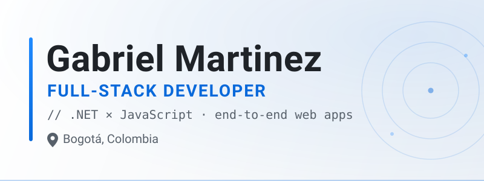

<picture>
  <source media="(prefers-color-scheme: dark)" srcset="https://raw.githubusercontent.com/jeisux92/jeisux92/main/assets/banner-dark.svg">
  
</picture>

 

I build web applications **end to end** — from .NET services and APIs to TypeScript, Vue and React interfaces, and the cloud plumbing that connects them. I like turning ideas into working products and picking up new tools along the way.

- 🔭 &nbsp;Working across the **.NET** and **JavaScript / TypeScript** ecosystems
- 🌱 &nbsp;Currently exploring **Generative AI** and **Cloud Architecture**
- 🧭 &nbsp;Background spans **C# / .NET**, **Vue / React / Angular**, and **Flutter**
- 💼 &nbsp;**Open to opportunities** — happy to connect
- 📍 &nbsp;Bogotá, Colombia (UTC−5)

 

## 🛠 &nbsp;Tech Stack

| Focus | Technologies |
| :-- | :-- |
| **Languages** |  |
| **Frontend** |  |
| **Backend & Cloud** |  |
| **Tools & Data** |  |

 

## 📊 &nbsp;GitHub Analytics

  <picture>
    <source media="(prefers-color-scheme: dark)" srcset="https://github-readme-stats.vercel.app/api?username=jeisux92&show_icons=true&hide_border=true&include_all_commits=true&count_private=true&theme=github_dark">
    
  </picture>
  &nbsp;&nbsp;
  <picture>
    <source media="(prefers-color-scheme: dark)" srcset="https://github-readme-stats.vercel.app/api/top-langs/?username=jeisux92&layout=compact&langs_count=8&hide_border=true&theme=github_dark">
    
  </picture>

 

## 🚀 &nbsp;Selected Work

| Project | What it does | Stack |
| :-- | :-- | :-- |
| [**store**](https://github.com/jeisux92/store) | E-commerce storefront built with Nuxt | Vue · Nuxt |
| [**Evidence-Tracker**](https://github.com/jeisux92/Evidence-Tracker) | Geolocate and track evidence on Google Maps | C# · .NET |
| [**library-api**](https://github.com/jeisux92/library-api) | Library management REST API | C# · .NET |
| [**nextjs-dotnet-core**](https://github.com/jeisux92/nextjs-dotnet-core) | Next.js frontend backed by a .NET Core API | Next.js · .NET |
| [**phone-book-app**](https://github.com/jeisux92/phone-book-app) | Contact / phone book manager | TypeScript |

<a href="https://github.com/jeisux92?tab=repositories">View all repositories →</a>

 

## 🤝 &nbsp;Connect

  
  &nbsp;
  
  &nbsp;
  

Always happy to talk about .NET, the web, and building useful things.
